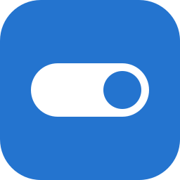

<p align="center"></p>

# oneSwitch

Switch from Windows to Linux in three questions. Run it on Windows, pick a layout
and what you use your PC for, and it writes an unattended installer that sets Linux
up with your apps.

- Picks the distro for you: Bazzite for gaming, Mint or Fedora for daily use (by layout),
  Debian for work and development, Arch for enthusiasts.
- Finds your programs, including Store apps and portable ones, and maps about 100
  of them to their Linux counterpart as an apt, dnf, AUR or Flatpak package.
- Rates your installed Steam games with ProtonDB before you switch.
- Checks that your GPU is supported. On Arch, NVIDIA cards get the open driver.
- The Mac-style layout on GNOME gets Dash to Dock, set up system-wide and working
  on first login.
- The installer only asks you to create your account. Your apps install and the
  desktop gets set up once, on first boot.
- Linux replaces Windows: Debian and Fedora take the whole disk, Arch lets you pick
  it.

Work in progress. Unattended installs work for Debian, Fedora and Arch, not yet
for Bazzite and Mint. Downloading the ISO, writing the USB drive and moving your
files are still to come.

## Run

Needs the .NET 10 SDK.

```sh
dotnet run --project OneSwitch
```

**Create migration files** saves the installer config and `oneswitch.sh` to
`Desktop/oneSwitch`. Debian and Fedora read theirs at install time; on Arch, run
`archinstall --config user_configuration.json`.

`package-for-vm.sh` builds a zip for testing in a Windows VM. On Linux the app
runs too, but only sees Linux programs and GPUs.

`Architecture.md` explains how each part works and why.

## License

GPL-3.0.
